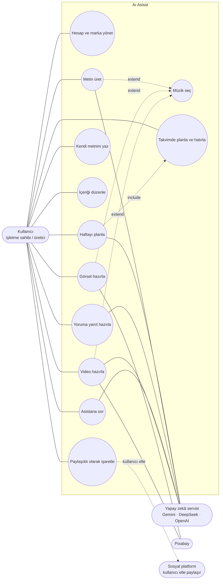
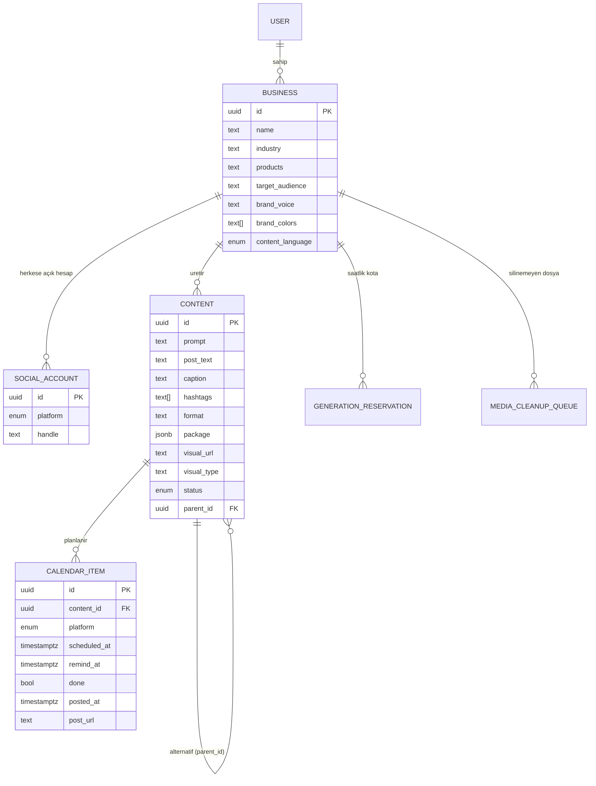
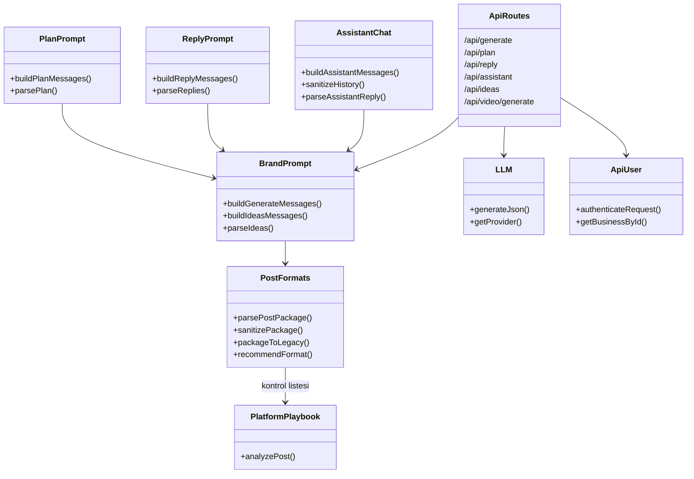
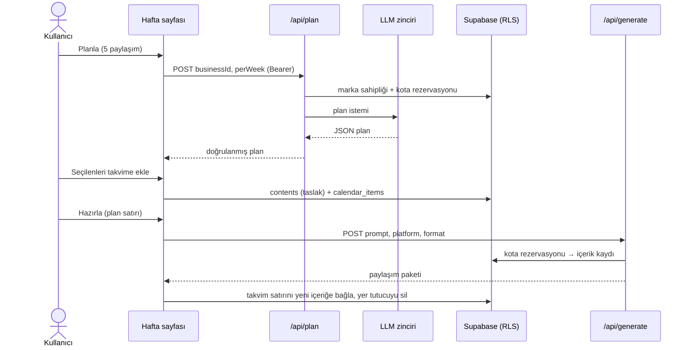
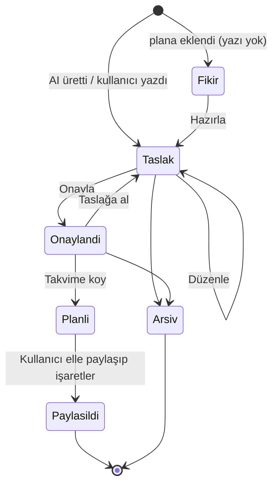
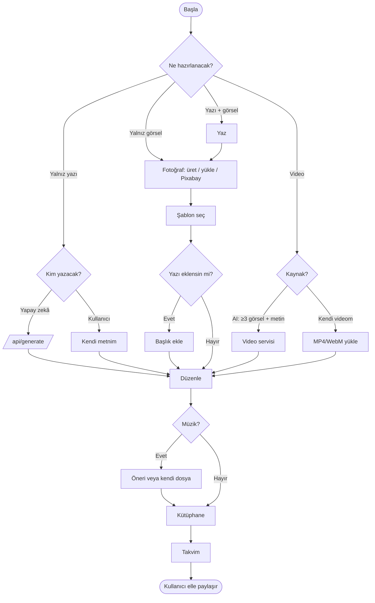
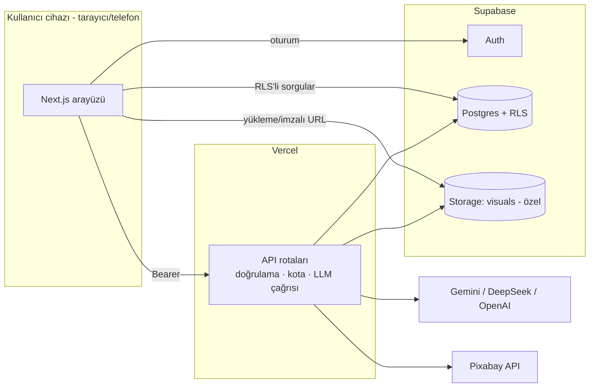

# 2. UML modelleri

Diyagramlar Mermaid ile yazıldı (GitHub'da doğrudan görünür). Kod değiştikçe bu dosya güncellenir: **bir akış/tablo değişen PR, ilgili diyagramı da değiştirir.**

> Ayrıntılı içerik hazırlama ve manuel yayın akışı (PlantUML): [`content-lifecycle.puml`](content-lifecycle.puml). Birlikte yapısının adımları: **Yaz → Düzenle → Görsel → Planla**.

## 2.1 Kullanım durumu diyagramı (Use Case)

Mermaid'de yerleşik use-case türü olmadığından aktörler yuvarlak, kullanım durumları oval kutu olarak çizilir.

## 2.2 Alan modeli / veri tabanı (ER)

## 2.3 Sınıf/modül diyagramı (saf mantık katmanı)

## 2.4 Dizi diyagramı — "Plandan içerik hazırla"

## 2.5 Durum diyagramı — içerik yaşam döngüsü

## 2.6 Etkinlik diyagramı — içerik üretim kararı

## 2.7 Dağıtım diyagramı

