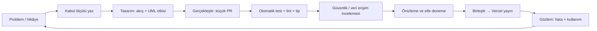

# Aı Asisst — Yazılım Geliştirme Süreci ve Tasarım Belgeleri

Bu klasör projenin **yaşam döngüsünü** (SDLC) tek yerde toplar. Model: **hafif çevik (Scrum-lite + Kanban)**, kısa döngüler, her döngü sonunda çalışan ve test edilmiş artım.
Kaynak: yaygın SDLC aşamaları — gereksinim, tasarım, gerçekleştirme, test, yayın, bakım (örn. [Flagsmith: SDLC aşamaları](https://www.flagsmith.com/blog/software-development-lifecycle), [Sparx: SDLC ve UML](https://sparxsystems.com/platforms/software_development_lifecycle.html)).

| Aşama | Çıktı | Belge |
|---|---|---|
| 1. Problem ve gereksinim | Problem tanımı, kişiler, kullanıcı hikâyeleri, kabul ölçütleri | [01-problem-ve-gereksinimler.md](01-problem-ve-gereksinimler.md) |
| 2. Analiz ve modelleme | UML: kullanım durumu, alan modeli, dizi, durum, etkinlik, dağıtım | [02-uml.md](02-uml.md) |
| 3. Mimari | Katmanlar, güvenlik sınırları, karar kayıtları (ADR) | [03-mimari-ve-kararlar.md](03-mimari-ve-kararlar.md) |
| 4. Tasarım (UX/UI) | Bilgi mimarisi, akışlar, tasarım sistemi, erişilebilirlik | [04-tasarim-sureci.md](04-tasarim-sureci.md) |
| 5. Gerçekleştirme + Test | Kod standardı, test piramidi, güvenlik incelemesi, "bitti" tanımı | [05-test-ve-kalite.md](05-test-ve-kalite.md) |
| 6. Yayın ve işletim | Ortamlar, CI/CD, migrasyon, geri alma, risk kaydı, yol haritası | [06-yayin-ve-isletim.md](06-yayin-ve-isletim.md) |

## Çalışma döngüsü (her özellik için)

Kural: **yapay zekâ ile yazılan her kod test edilir ve veri erişimi (RLS, sahiplik, kota) gözden geçirilir.** Otomatik paylaşım yoktur; paylaşımı kullanıcı yapar.
